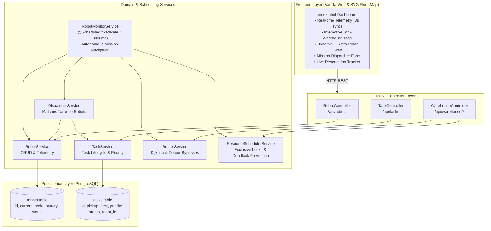
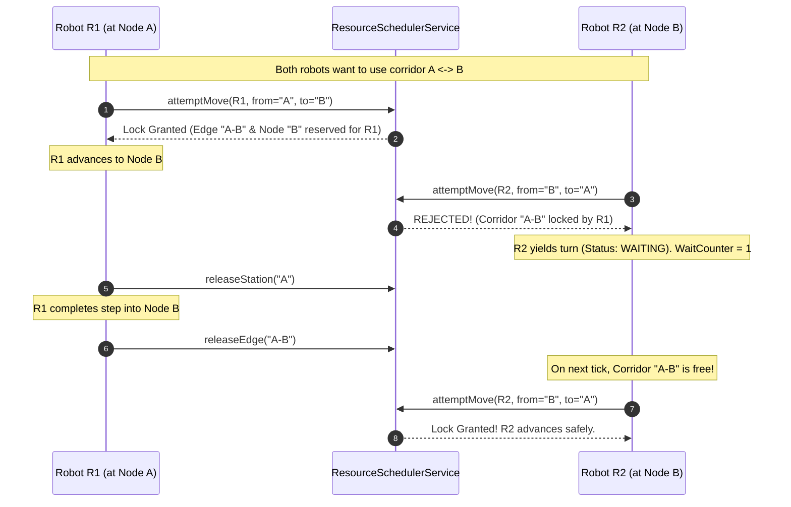

# Autonomous Robot Fleet Manager | Master Architectural Guide & Study Manual

Welcome to the complete architectural blueprint and study manual for the **Spring Boot Autonomous Robot Fleet Manager**. This manual documents the exact evolution of the system—from a simple cyclic robot tracker into a distributed, multi-agent autonomous guided vehicle (AGV) dispatch, routing, and collision-free traffic management system.

---

## 1. Visual Proof of Working Dashboard

Below is the live capture of the Autonomous AGV Command Center running on `http://localhost:8080`, showing the interactive 5-station topology map with glowing Dijkstra path calculation (`A ➔ C`), active mission queue, and AGV telemetry cards:


---

## 2. Executive System Architecture



---

## 3. Starting Point: The Baseline System

### What Existed Initially:
- **Robots Table**: Simple CRUD (`id`, `currentnode`, `batterypercent`, `status`).
- **Telemetry UI**: Basic grid displaying robot status cards (`IDLE`, `MOVING`, `CHARGING`).
- **Hardcoded Movement**: [`RobotMonitorService.java`](file:///c:/Users/Akansha/Downloads/fleetmanager/fleetmanager/src/main/java/com/example/fleetmanager/service/RobotMonitorService.java) moved robots cyclically in an endless loop:
  ```java
  String[] NODES = {"A", "B", "C", "D", "E"};
  // Hardcoded index increment without map or purpose:
  int nextIdx = (currentIdx + 1) % NODES.length;
  ```

### The Inherent Flaws:
1. **Aimless Movement**: Robots wandered without destinations, missions, or customer orders.
2. **No Collision Awareness**: Multiple robots could occupy the same station and corridor at the same time.
3. **No Topology**: Corridors had no distances or weights, rendering optimization impossible.
4. **No Mission Queuing**: Tasks could not be requested, prioritized, or tracked.

---

## 4. Phase-by-Phase Engineering Roadmap

```mermaid
journey
    title Fleet Manager Transformation Journey
    section Phase 1: Task Engine
      Create Task Entity & Statuses: 5: Akansha
      Implement Priority Queue: 5: Akansha
      REST API Endpoints: 5: Akansha
    section Phase 2: Graph & Dijkstra
      Define Warehouse Topology: 5: Akansha
      Implement Dijkstra Algorithm: 5: Akansha
      Interactive SVG Map in UI: 5: Akansha
    section Phase 3: Dispatcher Engine
      Match Eligible Idle Robots: 5: Akansha
      Prevent Double Assignment: 5: Akansha
      Lock Robot to Mission: 5: Akansha
    section Phase 4: Route Execution
      Navigate to Pickup Station: 5: Akansha
      Navigate to Destination: 5: Akansha
      Halt at Destination & Idle: 5: Akansha
    section Phase 5: Resource Scheduler
      Exclusive Station Node Locks: 5: Akansha
      Single-Lane Bidirectional Edge Locks: 5: Akansha
      Wait Cycle Deadlock Detection: 5: Akansha
      Dynamic Bypass Detour Re-routing: 5: Akansha
```

---

### Phase 1: Task Management Foundation

1. **Model ([`Task.java`](file:///c:/Users/Akansha/Downloads/fleetmanager/fleetmanager/src/main/java/com/example/fleetmanager/model/Task.java))**:
   - Primary Key: String `id` generated with `TSK-` prefix and UUID (`TSK-ED99D8`).
   - Fields: `pickupNode`, `destinationNode`, `priority` (1–10), `assignedRobotId`, timestamps.
2. **Lifecycle State Machine ([`TaskStatus.java`](file:///c:/Users/Akansha/Downloads/fleetmanager/fleetmanager/src/main/java/com/example/fleetmanager/model/TaskStatus.java))**:
   ```mermaid
   stateDiagram-v2
       [*] --> CREATED: User dispatches mission via REST / UI
       CREATED --> ASSIGNED: Dispatcher matches idle robot (battery >= 25%)
       ASSIGNED --> RUNNING: Robot reaches pickup station
       RUNNING --> COMPLETED: Robot reaches destination station
       RUNNING --> FAILED: Robot runs out of battery or encounters fatal error
       COMPLETED --> [*]
   ```
3. **Repository ([`TaskRepository.java`](file:///c:/Users/Akansha/Downloads/fleetmanager/fleetmanager/src/main/java/com/example/fleetmanager/repository/TaskRepository.java))**:
   - `findByStatusOrderByPriorityDescCreatedAtAsc(TaskStatus.CREATED)`: Ensures highest-priority missions are dispatched first (FIFO for equal priority).
   - `findActiveTaskForRobot(robotId)`: Ensures a robot cannot take another mission while executing one.

---

### Phase 2: Warehouse Graph & Dijkstra Shortest Path Router

1. **Topology Model ([`WarehouseGraph.java`](file:///c:/Users/Akansha/Downloads/fleetmanager/fleetmanager/src/main/java/com/example/fleetmanager/model/WarehouseGraph.java))**:
   - **5 Stations**: Node A (Alpha), Node B (Beta), Node C (Gamma), Node D (Delta), Node E (Epsilon).
   - **Outer Perimeter Corridors (Weight = 1 unit)**:
     - `A ↔ B` (1u), `B ↔ C` (1u), `C ↔ D` (1u), `D ↔ E` (1u), `E ↔ A` (1u).
   - **Cross-Aisle Diagonal Expressways (Weight = 2 units)**:
     - `B ↔ D` (2u), `A ↔ C` (2u).
2. **Routing Engine ([`RouterService.java`](file:///c:/Users/Akansha/Downloads/fleetmanager/fleetmanager/src/main/java/com/example/fleetmanager/service/RouterService.java))**:
   - Classic Dijkstra algorithm using `PriorityQueue<NodeDistance>`.
   - Guaranteed shortest total path cost.
   - Example routes:
     - Route `A ➔ C` via direct diagonal: `[A, C]` (distance = 2 units).
     - Route `A ➔ D` via perimeter: `[A, E, D]` (distance = 1 + 1 = 2 units).

---

### Phase 3 & 4: Dispatcher Engine & Route-Guided Navigation

1. **Dispatcher Engine ([`DispatcherService.java`](file:///c:/Users/Akansha/Downloads/fleetmanager/fleetmanager/src/main/java/com/example/fleetmanager/service/DispatcherService.java))**:
   - Triggered every monitor tick.
   - Scans for pending `CREATED` tasks.
   - Queries all robots with status `IDLE` and battery $\ge 25\%$.
   - Validates that the robot is not already linked to an active task.
   - Atomic assignment: Updates task to `ASSIGNED` and records `assignedRobotId`.
2. **Autonomous Movement Loop ([`RobotMonitorService.java`](file:///c:/Users/Akansha/Downloads/fleetmanager/fleetmanager/src/main/java/com/example/fleetmanager/service/RobotMonitorService.java))**:
   - If robot is at station $\neq$ `pickupNode`:
     - Calculates route to pickup station using Dijkstra.
     - Advances 1 station per cycle.
   - Once at `pickupNode`:
     - Task transitions to `RUNNING`.
   - While in `RUNNING`:
     - Calculates route to `destinationNode`.
     - Advances 1 station per cycle.
   - Once at `destinationNode`:
     - Task transitions to `COMPLETED`.
     - Robot status transitions to `IDLE` (halts and enters standby).

---

### Phase 5: Resource Scheduler, Collision Avoidance & Deadlock Prevention



1. **Station Mutual Exclusion**:
   - Station node locks prevent two robots from physically parking on the same station.
2. **Canonical Edge Locking**:
   - Corridors are single-lane tracks. To prevent head-on crashes, corridor keys are canonical:
     $$\text{EdgeKey} = \min(u, v) + \text{"-"} + \max(u, v)$$
   - Therefore, `A -> B` and `B -> A` share the identical lock key `"A-B"`.
3. **Deadlock Detection & Dynamic Detour**:
   - If a robot encounters an occupied station/corridor, it yields its turn (`status: WAITING`) and increments its `waitCounter`.
   - If `waitCounter >= 2` (potential circular deadlock):
     - `RouterService.findShortestPathAvoidingNodes` is invoked, excluding the blocked node from the graph.
     - The robot dynamically re-routes along an alternate bypass corridor (e.g. taking `B ➔ D ➔ E ➔ A` instead of waiting indefinitely at `B ➔ A`).

---

## 5. Master Command Cheat Sheet (CLI Manual)

### A. Server & Build Commands (Run in `c:\Users\Akansha\Downloads\fleetmanager\fleetmanager`)

```bash
# 1. Run all 18 Unit & Integration Tests:
cmd.exe /c "mvnw.cmd test"

# 2. Package into a Production JAR:
cmd.exe /c "mvnw.cmd clean package -DskipTests=false"

# 3. Launch Spring Boot Server:
cmd.exe /c "mvnw.cmd spring-boot:run"
```

---

### B. REST API Endpoints & cURL Commands

#### 1. Warehouse Topology & Dijkstra Routing
```bash
# Get entire warehouse map (nodes & edge weights)
cmd.exe /c "curl.exe -s http://localhost:8080/api/warehouse/graph"

# Calculate Dijkstra shortest path between two nodes (e.g., A to C)
cmd.exe /c "curl.exe -s \"http://localhost:8080/api/warehouse/route?from=A&to=C\""

# Inspect active station and edge reservations
cmd.exe /c "curl.exe -s http://localhost:8080/api/warehouse/reservations"
```

#### 2. Robot Management
```bash
# List all robots
cmd.exe /c "curl.exe -s http://localhost:8080/api/robots"

# Filter robots by status (IDLE, MOVING, CHARGING, WAITING)
cmd.exe /c "curl.exe -s \"http://localhost:8080/api/robots?status=IDLE\""

# Filter robots by station node
cmd.exe /c "curl.exe -s \"http://localhost:8080/api/robots?node=A\""

# Register a new robot
cmd.exe /c "curl.exe -s -X POST -H \"Content-Type: application/json\" -d \"{\"id\":\"R99\",\"currentnode\":\"A\",\"batterypercent\":100,\"status\":\"IDLE\"}\" http://localhost:8080/api/robots"

# Delete / Decommission a robot
cmd.exe /c "curl.exe -s -X DELETE http://localhost:8080/api/robots/R99"
```

#### 3. Mission Task Management
```bash
# Dispatch a new task (Pickup at Node A, Destination at Node C, Priority 10)
cmd.exe /c "curl.exe -s -X POST -H \"Content-Type: application/json\" -d \"{\"pickupNode\":\"A\",\"destinationNode\":\"C\",\"priority\":10}\" http://localhost:8080/api/tasks"

# View all tasks (ordered by Priority and Creation timestamp)
cmd.exe /c "curl.exe -s http://localhost:8080/api/tasks"

# Dispatch two simultaneous opposing missions to verify collision avoidance:
cmd.exe /c "curl.exe -s -X POST -H \"Content-Type: application/json\" -d \"{\"pickupNode\":\"A\",\"destinationNode\":\"C\",\"priority\":10}\" http://localhost:8080/api/tasks & curl.exe -s -X POST -H \"Content-Type: application/json\" -d \"{\"pickupNode\":\"C\",\"destinationNode\":\"A\",\"priority\":9}\" http://localhost:8080/api/tasks"
```

---

### C. PostgreSQL Database Inspection

```bash
# Direct PSQL query to inspect task records:
"C:\Program Files\PostgreSQL\18\bin\psql.exe" -U postgres -d fleetdb -c "SELECT id, pickup_node, destination_node, priority, status, assigned_robot_id FROM tasks ORDER BY created_at DESC LIMIT 10;"

# Direct PSQL query to inspect robot status and locations:
"C:\Program Files\PostgreSQL\18\bin\psql.exe" -U postgres -d fleetdb -c "SELECT id, current_node, battery_percent, status FROM robots ORDER BY id ASC;"
```

---

## 6. How to Export this Study Guide to PDF

You can easily generate a styled PDF from this manual using any of the following methods:

### Option 1: Chrome / Edge Browser (Zero Install)
1. Open this file in Chrome, Edge, or VS Code Markdown Preview (`Ctrl + Shift + V`).
2. Press `Ctrl + P` (Print).
3. Select **"Save as PDF"**.
4. Check **"Background graphics"** and click **Save**.

### Option 2: Command Line via `npx md-to-pdf`
```bash
cmd.exe /c "npx -y md-to-pdf C:\Users\Akansha\.gemini\antigravity-ide\brain\0f31594f-da27-4fad-9d8a-fc95af6ca5c4\FLEET_MANAGER_MASTER_STUDY_GUIDE.md"
```

---

## 7. Automated Test Suite Summary (18/18 Passing)

| Test File | Method Tested | Assertion / Verified Behavior |
| :--- | :--- | :--- |
| [`TaskServiceTests.java`](file:///c:/Users/Akansha/Downloads/fleetmanager/fleetmanager/src/test/java/com/example/fleetmanager/TaskServiceTests.java) | `testCreateTask` | Generates UUID prefix, status `CREATED`, timestamps |
| [`TaskServiceTests.java`](file:///c:/Users/Akansha/Downloads/fleetmanager/fleetmanager/src/test/java/com/example/fleetmanager/TaskServiceTests.java) | `testPriorityOrdering` | Priority 10 task scheduled before Priority 2 |
| [`RouterServiceTests.java`](file:///c:/Users/Akansha/Downloads/fleetmanager/fleetmanager/src/test/java/com/example/fleetmanager/RouterServiceTests.java) | `testDirectDiagonal` | Path A &rarr; C is 1 step, cost = 2 units |
| [`RouterServiceTests.java`](file:///c:/Users/Akansha/Downloads/fleetmanager/fleetmanager/src/test/java/com/example/fleetmanager/RouterServiceTests.java) | `testDetourAvoidance` | Node C blocked &rarr; calculates alternate route through B |
| [`DispatcherServiceTests.java`](file:///c:/Users/Akansha/Downloads/fleetmanager/fleetmanager/src/test/java/com/example/fleetmanager/DispatcherServiceTests.java) | `testDispatchMatching` | Assigns highest priority task to eligible idle robot |
| [`DispatcherServiceTests.java`](file:///c:/Users/Akansha/Downloads/fleetmanager/fleetmanager/src/test/java/com/example/fleetmanager/DispatcherServiceTests.java) | `testBatteryThreshold` | Rejects robots with battery &lt; 25% |
| [`ResourceSchedulerTests.java`](file:///c:/Users/Akansha/Downloads/fleetmanager/fleetmanager/src/test/java/com/example/fleetmanager/ResourceSchedulerTests.java) | `testExclusiveNodeLock` | Second robot blocked from claiming occupied station |
| [`ResourceSchedulerTests.java`](file:///c:/Users/Akansha/Downloads/fleetmanager/fleetmanager/src/test/java/com/example/fleetmanager/ResourceSchedulerTests.java) | `testOpposingCorridorLock`| `B->A` blocked when `A->B` is locked |
| [`ResourceSchedulerTests.java`](file:///c:/Users/Akansha/Downloads/fleetmanager/fleetmanager/src/test/java/com/example/fleetmanager/ResourceSchedulerTests.java) | `testDeadlockDetour` | Wait counter $\ge 2$ triggers dynamic bypass |

---
*Autonomous Robot Fleet Manager — Engineering Manual & Study Guide.*
